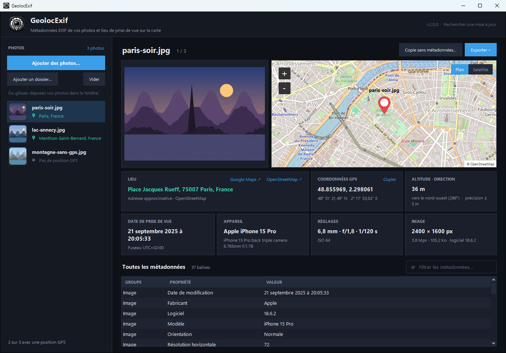
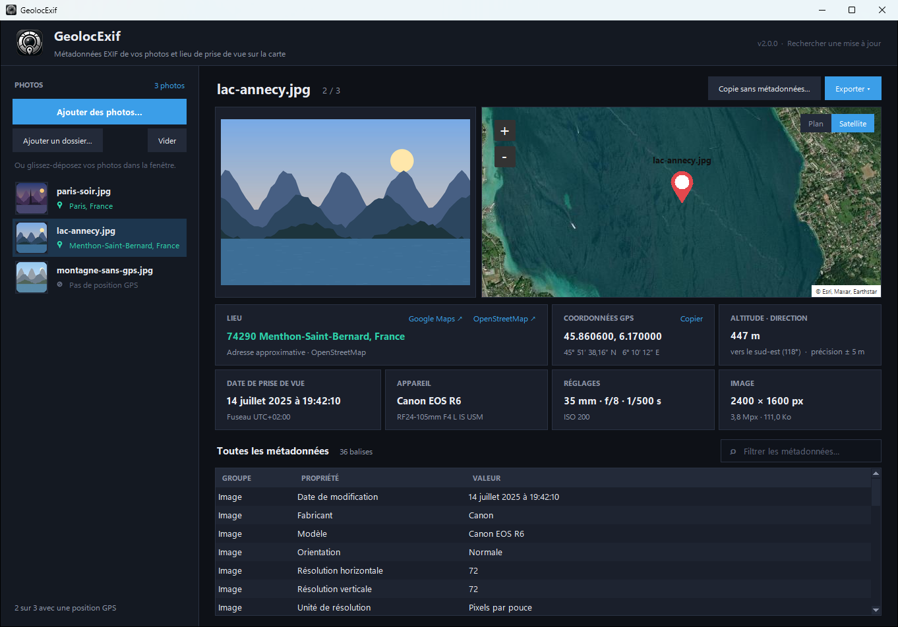
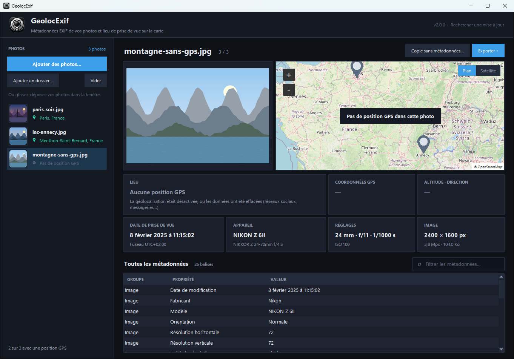

# GeolocExif

Découvrez **où et comment une photo a été prise** : GeolocExif lit les métadonnées EXIF enregistrées par l'appareil photo ou le téléphone, affiche le lieu sur une carte et retrouve l'adresse la plus proche.

## Télécharger

👉 **[GeolocExif.exe](https://github.com/dev-leturfu/GeolocExif/releases/latest/download/GeolocExif.exe)** (Windows 10 / 11, dernière version)

Un seul fichier, rien à installer : double-cliquez et c'est parti.

## Fonctionnalités

- **Toutes vos photos** : JPEG, **HEIC (iPhone)**, PNG, TIFF, WebP et DNG.
  - Ajoutez des fichiers ou un dossier entier, ou glissez-déposez-les dans la fenêtre.
  - Vous pouvez aussi faire glisser des photos sur l'icône du programme.
- **Le lieu sur la carte**, en vue *Plan* (OpenStreetMap) ou *Satellite*. Chaque photo géolocalisée a son repère ; cliquez dessus pour l'afficher.
- **L'adresse approximative** du lieu de prise de vue, par exemple « Place Jacques Rueff, 75007 Paris, France ».
- **Les informations essentielles en un coup d'œil** :
  - coordonnées GPS en degrés décimaux et en degrés, minutes, secondes ;
  - altitude, direction de prise de vue et précision ;
  - date et heure, avec le fuseau horaire ;
  - appareil et objectif ;
  - réglages (focale, ouverture, vitesse, ISO) ;
  - dimensions de l'image.
- **Toutes les métadonnées** dans un tableau, en français et en valeurs lisibles (« 1/500 s », « f/8 », « 447 m » plutôt que des fractions brutes), avec un filtre de recherche.
- **Ouvrir le lieu** dans Google Maps ou OpenStreetMap, ou copier les coordonnées en un clic.
- **Exports** :
  - rapport `.txt` d'une photo ;
  - tableau `.csv` de toutes les photos (s'ouvre dans Excel) ;
  - fichier `.kml` des positions pour Google Earth ;
  - capture de la carte en `.png`.
- **Copie sans métadonnées** : enregistre une copie de la photo sans aucune donnée EXIF (ni position, ni appareil, ni date), pour la partager en toute tranquillité. L'original n'est jamais modifié.
- **Mises à jour automatiques** : l'application vous prévient quand une nouvelle version sort et l'installe en un clic.

### Vue satellite

### Photo sans position GPS

Les autres photos restent visibles sur la carte. Une photo n'a pas de position quand la géolocalisation de l'appareil était désactivée, ou quand les données ont été effacées. C'est le cas des photos envoyées par la plupart des réseaux sociaux et des messageries.

## Raccourcis

| Touche | Action |
| --- | --- |
| `Ctrl + O` | Ajouter des photos |
| `↑` / `↓` | Photo précédente / suivante |
| `Suppr` | Retirer la photo de la liste |
| `Ctrl + F` | Filtrer les métadonnées |
| `Ctrl + S` | Enregistrer le rapport de la photo |
| Double-clic sur une ligne | Copier la valeur |
| Double-clic sur l'aperçu | Ouvrir la photo |

## Confidentialité

Les photos ne quittent jamais votre ordinateur. Seuls deux types de requêtes partent sur Internet :
- le téléchargement des fonds de carte ;
- la recherche d'adresse : les coordonnées seules sont envoyées au service Nominatim d'OpenStreetMap.

## Remarques

- Windows SmartScreen peut afficher un avertissement au premier lancement, car le programme n'est pas signé : cliquez sur *Informations complémentaires*, puis sur *Exécuter quand même*.
- Les adresses viennent d'OpenStreetMap et restent approximatives.
- Fonds de carte : © les contributeurs d'OpenStreetMap ; imagerie satellite : © Esri, Maxar, Earthstar Geographics.
